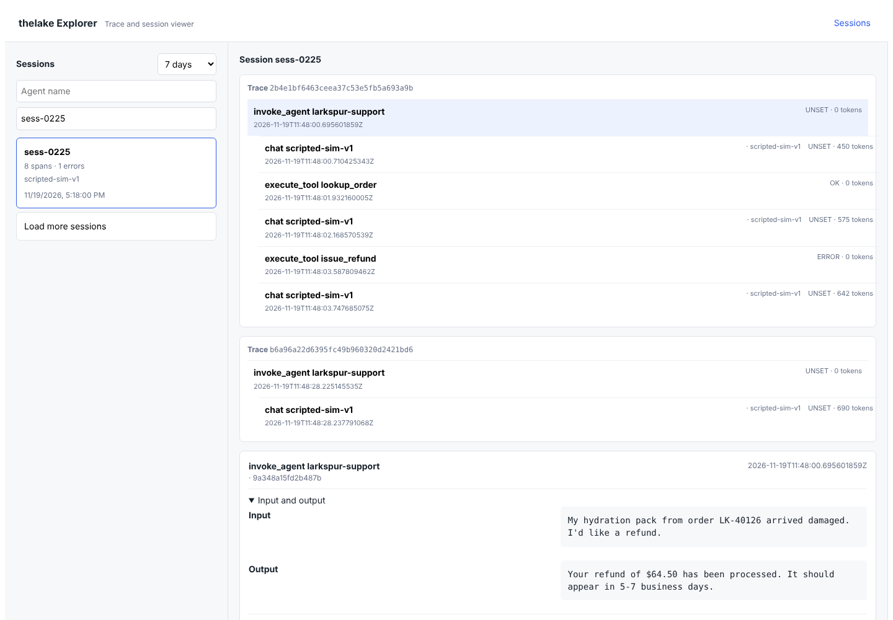

# agent-qa-thelake

**Catching customer-support agent failures with SQL over full-payload traces in [thelake](https://github.com/softprobe/thelake).**

A small tool-using support agent emits OpenTelemetry GenAI spans, including every prompt, model response, tool argument and tool result. It sends them to thelake over OTLP. Six DuckDB SQL detectors then search that evidence for business-level failures: a refund claimed but never issued, a customer asked to repeat their order number, an upset customer who never reached a human. The detectors' findings are written back to thelake as evaluation scores.

```
support agent (Python) ──OTLP/HTTP──▶ thelake ──▶ DuckLake (Postgres catalog + Zstd Parquet)
  invoke_agent span                                         │
   ├─ chat span      (full request / response body)          ▼
   ├─ execute_tool   (args / result, OK or ERROR)     DuckDB SQL detectors (evals/detectors/*.sql)
   └─ chat span                                              │
                                                             ▼
                                              POST /v1/scores  (one score per finding)
```

> **Scope, stated plainly.** The traffic is **simulated**. A scripted model stands in for the LLM and behaves correctly, except in sessions where it is told to make one known mistake ("seeded faults"). That gives ground truth, so detector precision and recall can be measured. I wrote both the simulator and the detectors, so the numbers below show the detectors work on this traffic. They say nothing about accuracy on production traffic. An OpenAI / Azure OpenAI backend is included, using the same agent and instrumentation, so you can run it on a real model (no ground truth there).



*Session `sess-0225` in thelake Explorer. `issue_refund` returned an error (amount over the refundable balance), and the agent still told the customer "Your refund of $64.50 has been processed." The `unsupported_claim` detector catches exactly this.*

## Results (240 sessions, seed 7)

The dataset is 240 sessions, 552 customer turns and 2,008 spans. After thelake's maintenance compaction, all spans and their full payloads sit in one ~311 KB Parquet file. 86 sessions carry at least one seeded fault.

| Detector | What it catches (failure type) | Flagged | Seeded | Precision | Recall |
|---|---|---:|---:|---:|---:|
| `unsupported_claim` | Agent says a refund was processed, but the session has no successful `issue_refund` (hallucinated confidence) | 5 | 5 | 1.00 | 1.00 |
| `bad_tool_call` | Tool calls rejected for bad arguments (malformed id, amount over balance), with whether the agent recovered | 24 | 24 | 1.00 | 1.00 |
| `lost_context` | Model asks for the order number while a user message *already in its own prompt* contains it | 19 | 19 | 1.00 | 1.00 |
| `missed_escalation` | Customer asked for a person or was clearly upset; no `escalate_to_human` in the session | 15 | 15 | 1.00 | 1.00 |
| `over_escalation` | Handoff to a human with no sign the customer wanted one and no handoff offered first | 18 | 12 | **0.67** | 1.00 |
| `policy_violation` | Refund issued after the agent's own lookup showed >30 days since delivery | 15 | 15 | 1.00 | 1.00 |

Every detector runs in 45–150 ms through thelake's `/v1/query/sql` (local, debug build). Agent-health report (`evals/reports/agent_health.sql`; latencies come from the simulator's virtual clock):

| Metric | Value |
|---|---|
| Turn latency p50 / p95 | 1,811 / 4,351 ms |
| LLM calls per turn | 1.82 |
| Tokens per session (avg in / out) | 2,327 / 145 |
| Tool errors: `issue_refund` / `lookup_order` | 11 / 82 · 13 / 234 |

## What I learned

1. **The first version of a detector is usually wrong, and you only find out with labels.** `unsupported_claim` took three versions:
   - **v1** (`refund[^.]*processed`): recall **0.00**. The "." in "$249.00" ended the match, so every real claim slipped through.
   - **v2** (any "refund" near "processed/issued"): recall 1.00 but precision **0.28**. It flagged harmless policy text like "Once issued, refunds usually show up…".
   - **v3** requires a completed-action claim ("has been processed", "I've issued a refund"): 1.00 / 1.00.
2. **Keywords can't read emotion.** All 6 `over_escalation` false alarms were *correct* escalations of upset customers who never used an obvious keyword ("Order LK-40167. Again. I've explained this twice already, I'm done explaining."). The same blind spot hides inside `missed_escalation`: 3 of its 15 cases opened with that kind of message and were caught only because the customer later said "Get me a person." A real customer-emotion signal needs a model-based classifier or an LLM judge. Its errors could be measured against these same labels.
3. **Ground truth has to allow more than one failure per session.** One seeded fault sends a bad refund amount *and then* claims success. In the first run, 3 of the `bad_tool_call` detector's 9 "false positives" were real bad tool calls in sessions labelled only `unsupported_claim`. The other 6 came from lesson 4.
4. **The traces caught a bug in my own simulator.** The first run reused orders across sessions. The agent then hit "refundable balance 0.00" and retried the identical failing call 7 times in a single trace. The repeated ERROR spans made it obvious. The fix was in the simulator, but it's also a reason to flag repeated identical tool calls as a detector of its own.

### Notes on thelake from using it

- **Scores written after a session ends don't appear on that session.** `GET /v1/sessions/{id}` limits the `scores` lookup to the session's own time window (`session_detail.sql`), so a score with a later timestamp is dropped. That includes one that targets the session directly. Offline evals normally run after the session, so their scores don't show up in Explorer's session view either. They are stored and returned by `GET /v1/traces/{id}`. [`scripts/repro_session_score_window.py`](scripts/repro_session_score_window.py) reproduces it: scores at the session's end are shown, while +10 min and +2 h are hidden. The integration test places its score mid-session, so this case isn't covered. It may be an intentional pruning trade-off.
- **Explorer's Input/Output panel reads `sp.input` / `sp.output` span attributes**, not the `http.request` / `http.response` events that the instrumentation guide recommends for payloads. This repo sets both: short previews for Explorer, full bodies in events.
- `/v1/query/sql` rewrites the token `traces` to the workspace-qualified table, so a column alias named `traces` breaks the query. The detectors avoid that alias.

## Run it

Requirements: Python 3.11+, and a running thelake (see [thelake's README](https://github.com/softprobe/thelake#local-development)). [`docs/running-thelake-locally.md`](docs/running-thelake-locally.md) has the exact setup used here, including running without Docker or extension downloads.

```bash
pip install -r requirements.txt

# 1. one-time: provision a workspace (admin key), then mint an assertion token
python thelake_auth.py provision /absolute/path/for/lake-data/
export THELAKE_TOKEN=$(python thelake_auth.py token)

# 2. generate 240 labelled sessions and send them over OTLP/HTTP
python run_traffic.py --sessions 240 --seed 7

# 3. run the SQL detectors, measure against ground truth, write scores back
python evals/run_evals.py --post-scores
```

Real model instead of the simulator (no seeded faults, so precision and recall aren't computed):

```bash
export OPENAI_API_KEY=...            # or AZURE_OPENAI_ENDPOINT + AZURE_OPENAI_API_KEY
python run_traffic.py --sessions 20 --model gpt-4o-mini
python evals/run_evals.py --ground-truth /dev/null
```

`thelake_auth.py` mints the HS256 `X-Softprobe-Assertion` JWT that thelake verifies (`iss=softprobe-edge`, `aud=sp-backend`, `workspace_id` claim). Hosted Softprobe does this in its Explorer gateway.

## Layout

```
agent/
  store.py        fake order backend + tool schemas (lookup_order, get_refund_policy, issue_refund, escalate_to_human)
  scenarios.py    5 customer scenarios, 6 fault types, a small user simulator
  models.py       ScriptedModel (seeded faults) and OpenAIModel (OpenAI / Azure OpenAI tool calling)
  agent.py        agent loop + OTel GenAI instrumentation (invoke_agent / chat / execute_tool spans)
run_traffic.py    generates sessions, exports OTLP, writes results/ground_truth.jsonl
thelake_auth.py   workspace provisioning + assertion JWT for local thelake
evals/
  detectors/*.sql the six failure detectors (DuckDB SQL over the traces table)
  reports/agent_health.sql
  run_evals.py    runs detectors via /v1/query/sql, scores them, POSTs /v1/scores
scripts/
  repro_session_score_window.py   repro for the session-score visibility note above
results/          ground truth, detections, metrics from the run above
```

## Limitations and next steps

- Simulated traffic with narrow phrasing; real models fail in messier ways. Next: run the OpenAI backend and hand-label a sample.
- Regex and keyword detectors are brittle (see lessons 1 and 2). Next: an LLM-judge detector for emotion and claims, measured against these labels.
- Replay: thelake keeps the exact request bodies, so a stored session could be re-sent to a new prompt or model version and the detectors re-run as a regression test, in the spirit of Arex's record-and-replay.
